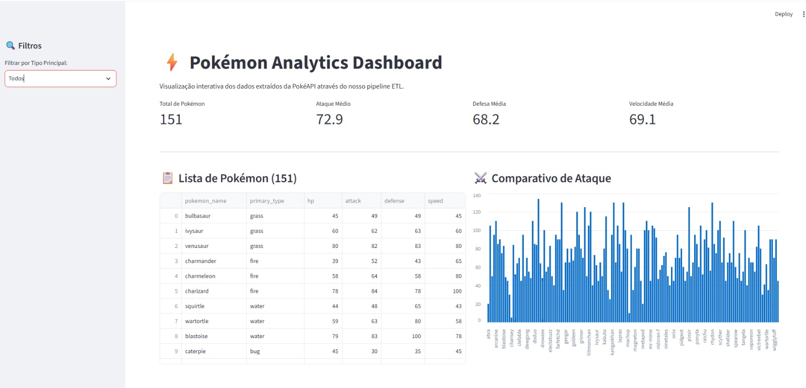
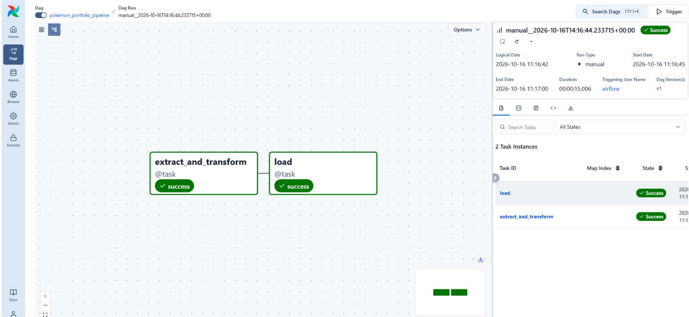

# Pokémon Analytics Dashboard

> Um pipeline de Engenharia de Dados de ponta a ponta que extrai dados da PokéAPI, orquestra o fluxo com Apache Airflow, armazena-os num banco de dados relacional PostgreSQL e disponibiliza um dashboard interativo construído em Streamlit.



---

## Tecnologias Utilizadas

- **Linguagem:** Python 3.10+
- **Orquestração:** Apache Airflow
- **Base de Dados:** PostgreSQL (via Docker)
- **Gestão de Cache / Filas:** Redis
- **Processamento de Dados:** Pandas & SQLAlchemy
- **Dashboard / UI:** Streamlit
- **Containerização:** Docker & Docker Compose

---

## Arquitetura do Projeto

1. **Extração & Carga (ETL):** Recolha de dados detalhados dos Pokémon a partir da [PokéAPI](https://pokeapi.co/).
2. **Orquestração:** Automação e agendamento das tarefas de engenharia de dados através de DAGs do Apache Airflow.
3. **Armazenamento:** Persistência estruturada numa base de dados PostgreSQL otimizada para consultas analíticas.
4. **Visualização:** Aplicação web interativa em Streamlit com filtros por tipo, métricas (KPIs) e gráficos comparativos de atributos.

### Fluxo da DAG no Apache Airflow


---

## Como Executar o Projeto Localmente

### 1. Pré-requisitos
- Ter o [Docker](https://www.docker.com/) e o Docker Compose instalados.
- Ter o Python instalado com o ambiente virtual configurado.

### 2. Clonar o Repositório
```bash
git clone https://github.com/cardosogg/pokemon-analytics.git
cd pokemon-analytics
